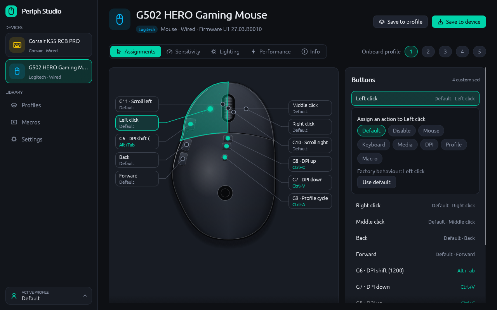
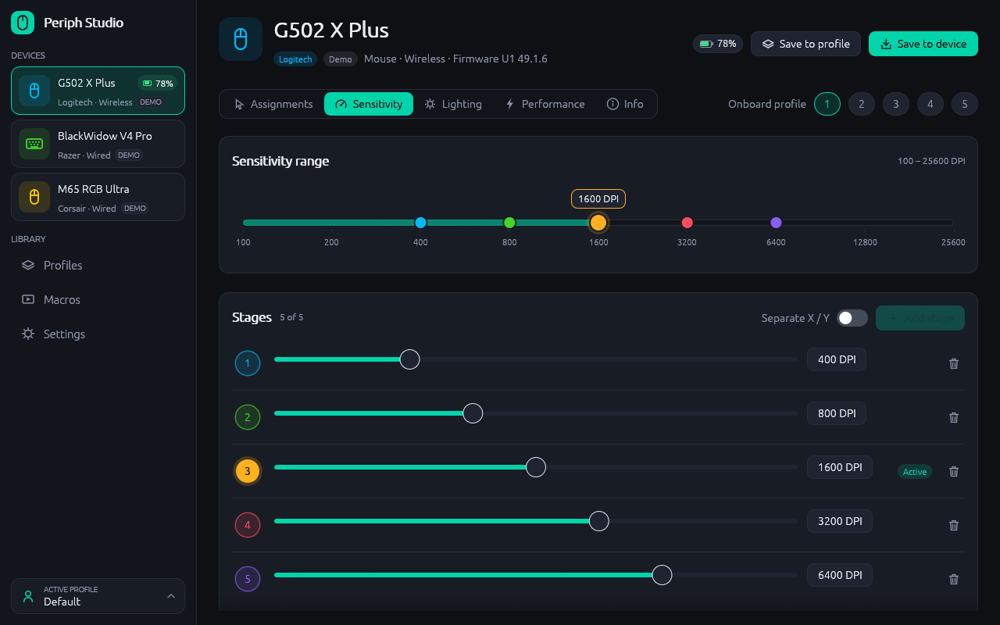
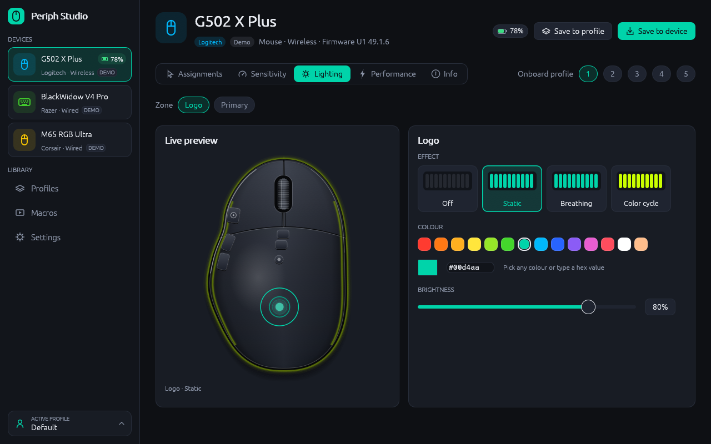
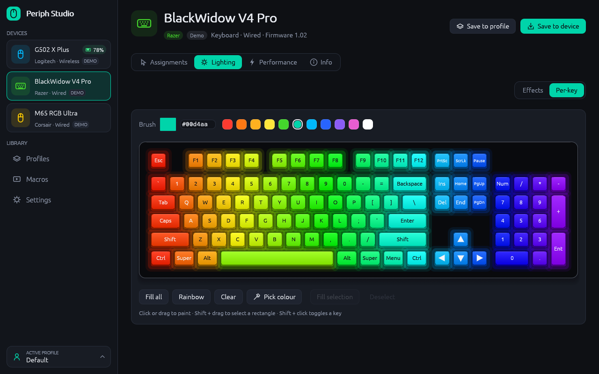
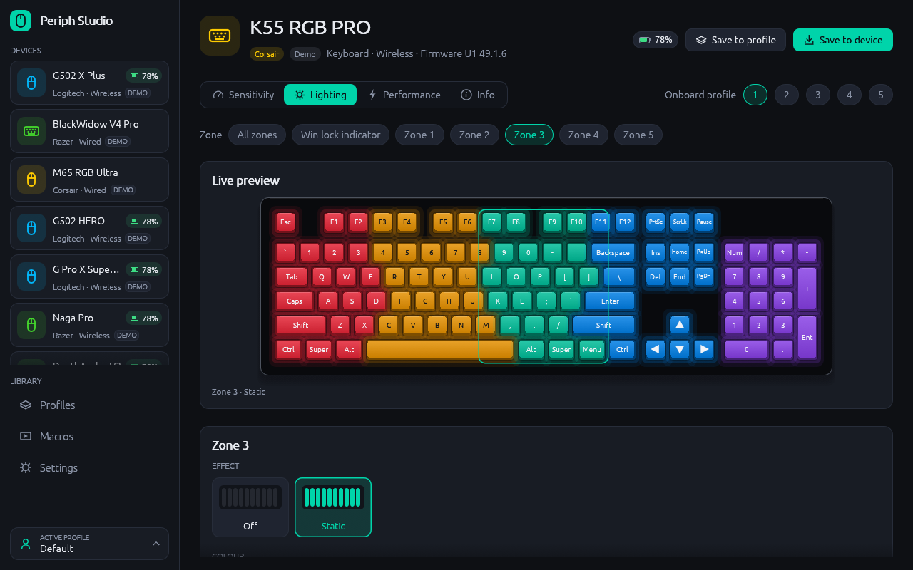
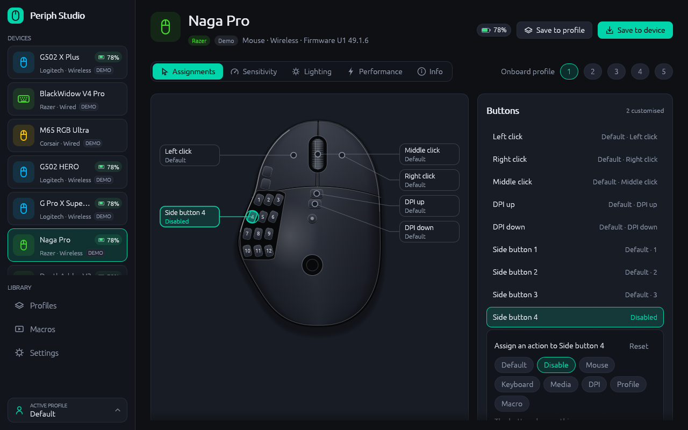
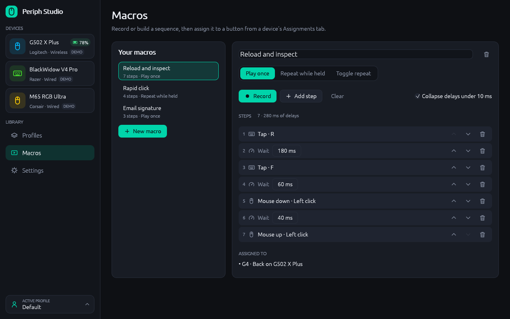

# Gearwise

One lightweight app to configure gaming mice and keyboards from **Logitech,
Razer, Corsair and SteelSeries** on **Linux and Windows** — DPI stages,
report rate, RGB lighting (zones and per-key), button assignments, onboard
profiles, macros and per-application profiles. An open alternative to
G HUB, Synapse, iCUE and GG that ships as a single small native binary.



| | |
|---|---|
|  |  |
|  |  |
|  |  |

## Highlights

- **Native and light** — one Rust binary (egui + glow), no Electron, no
  background services, no account. Idle CPU is ~0; it only redraws on
  input, device events or while an animated lighting preview is on screen.
- **Every control in one place**
  - *Sensitivity*: up to 5 DPI stages, active stage, X/Y split where the
    sensor allows it, snapped to the sensor's real step.
  - *Lighting*: per-zone effects (static, breathing, colour cycle, wave,
    reactive — whatever the device supports), colour, speed, brightness;
    per-key painting for RGB keyboards.
  - *Assignments*: any button to a mouse button, keystroke with modifiers,
    media key, DPI up/down/cycle/shift, profile cycle, disable, or a
    software macro.
  - *Performance*: report rate up to 8 kHz, lift-off distance, angle
    snapping, keyboard game mode.
  - *Onboard profiles*: switch and save device-stored profiles; settings
    survive moving the mouse to another PC.
- **Macros** — recorded or hand-edited (keys, mouse buttons, delays, text),
  play once / while held / toggle; played back through `uinput` on Linux and
  `SendInput` on Windows.
- **Per-app profiles** — switch automatically when a game gains focus
  (Windows, and X11/XWayland windows on Linux).
- **Profiles follow you** — every change is recorded in the active
  profile and re-applied when a device connects, sending only what
  differs (so onboard memory isn't rewritten on every launch). Colours on
  software-lit keyboards stay while the app runs.
- **Demo devices** — explore everything without hardware (Settings → Show
  demo devices).

## Supported hardware

| Brand | Protocol | Coverage |
|---|---|---|
| Logitech | HID++ 2.0 (wired, Lightspeed / Unifying / Bolt receivers, Bluetooth) | Discovered from the device's feature table, so G-series and MX devices work without a model list: DPI, report rate incl. 2/4/8 kHz, LED zones, per-key RGB, onboard profiles with button bindings, G-keys and diverted buttons for software actions, battery |
| Razer | Chroma 90-byte feature reports | 34 models — DeathAdder, Viper, Basilisk, Naga, Cobra, BlackWidow, Huntsman, Ornata: DPI and stages, polling incl. HyperPolling, zone effects, per-key RGB, battery |
| Corsair | Bragi and legacy (NXP) | ~45 models — M65, Dark Core, Katar, Ironclaw, Harpoon, Scimitar, K55/K65/K70/K95/K100, Slipstream receivers: DPI, polling, static zone and per-key colour, battery |
| SteelSeries | Rival / Sensei / Aerox / Prime | Sensitivity presets, polling, colours, button mapping, save to device |

Tested on real hardware so far: Logitech G502 HERO (wired, onboard
profiles — read, write, restore verified byte-for-byte), Lightspeed
receiver (C539), Corsair K55 RGB PRO (zone lighting). Everything else is implemented from
the published protocol work of libratbag, Solaar, OpenRazer, OpenRGB,
ckb-next and rivalcfg and covered by byte-exact unit tests against emulated
firmware — reports from owners of other devices are very welcome.

## Install

### Linux

```bash
cargo build --release -p gearwise
sudo packaging/linux/install-udev-rules.sh   # once: lets your user open the devices
./target/release/gearwise
```

The udev rule grants the logged-in user access to these vendors' HID
interfaces and to `/dev/uinput` (for macros) — the same model Solaar and
OpenRGB use. Replug devices after installing it.

### Windows

```bash
cargo build --release -p gearwise
```

Run `target\release\gearwise.exe`. Close G HUB / Synapse / iCUE / GG
first: they can hold devices exclusively or overwrite settings.

## How it works

```
app (egui UI)  ──commands──▶  worker thread  ──▶  DeviceManager
      ▲                           │                   │
      └────────events─────────────┘          drivers: logitech · razer
                                              corsair · steelseries
                                                       │
                                               gearwise-hid (hidapi)
```

| Crate | Purpose |
|---|---|
| `gearwise-core` | Vendor-neutral model: capabilities, state, settings, profiles, macros, device manager, demo devices, mock transport for tests |
| `gearwise-hid` | hidapi backend (pure-Rust on both platforms — no libudev or C toolchain needed) |
| `gearwise-logitech` / `-razer` / `-corsair` / `-steelseries` | Protocol drivers |
| `gearwise-input` | Macro playback (`uinput` / `SendInput`) and focused-application detection |
| `app` | The desktop UI |

The UI never blocks on device I/O: changes are applied optimistically and
confirmed by the worker. Onboard-memory writes are batched (a short delay
after the last change) so dragging a slider never hammers flash.

## Development

```bash
cargo test --workspace
cargo clippy --workspace --all-targets -- -D warnings
cargo run -p gearwise-logitech --example probe   # read-only dump of connected Logitech devices
cargo run -p gearwise-corsair --example probe
```

## License

MIT
